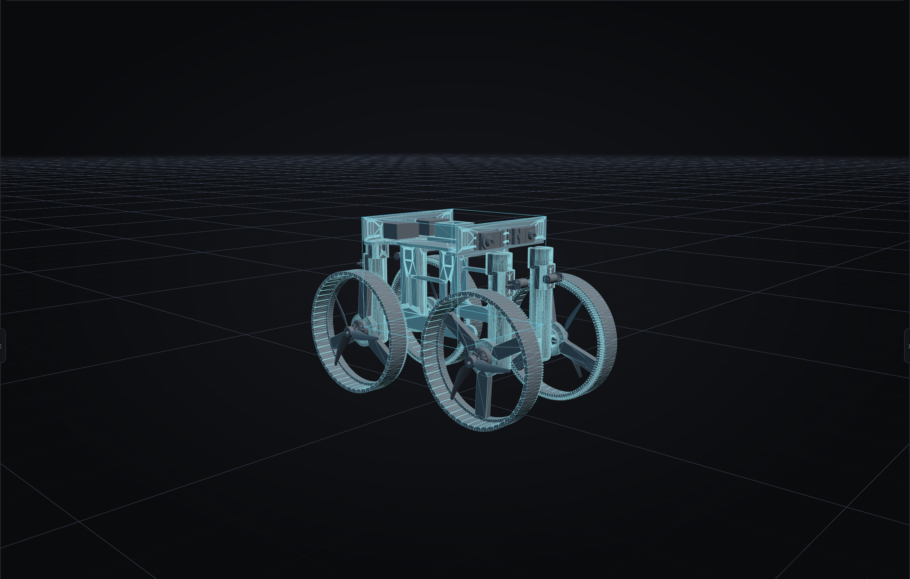
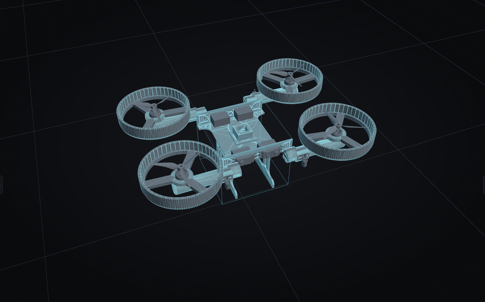

# ArduPilot + Gazebo + QGroundControl (macOS)

A reproducible ArduCopter SITL development setup for Apple Silicon Macs:
native software-in-the-loop simulation, physically realistic flight in
Gazebo Harmonic, and QGroundControl as the ground control station —
verified end-to-end with an actual takeoff and hover.

## Drone-Wheels

Drone-Wheels is a quadcopter that turns into a four-wheel car. Its Gazebo model  
is in `sim/models/Evo-Borne/` (generated — see its `generator/README.md`).

| Car mode (legs down) | Drone mode (legs unfolded) |
|---|---|
|  |  |

## What's here

- **ArduPilot** (`ardupilot/`, git submodule) — the flight stack, built for SITL.
- **ardupilot_gazebo** (`ardupilot_gazebo/`, git submodule) — the official
plugin that bridges ArduPilot's physics backend to Gazebo over UDP.
- **sim/** — the Evo-Borne Gazebo model (`sim/models/`) and world
(`sim/worlds/evo_borne_runway.sdf`).
- **scripts/** — small pymavlink test scripts (`legs.py` fold/unfold,
`drive_forward.py`).
- **tuning/** — automated flight-test / PID tuning pipeline (see
`tuning/README.md`).
- **Dockerized SITL** (`docker/`) — an alternative,
reproducible way to build and run just the SITL binary in a container
(Gazebo and QGroundControl still run natively — GUI passthrough in Docker
isn't reliable on macOS).
- **docs/** — `MavProxy_Commands.md`, images, and
`SETUP_STATUS.md`: the full setup log: every command run, every
macOS-specific issue hit (Homebrew tap trust, keg-only Qt5, Command Line
Tools, GID collisions, etc.) and how it was fixed. Read this if something
below doesn't work as expected.

## Capabilities

- Native ArduCopter SITL build and run (Apple Silicon)
- Gazebo Harmonic physics simulation via the `ardupilot_gazebo` plugin
(IMU, GPS, and full rigid-body dynamics — not ArduPilot's built-in toy
physics model)
- QGroundControl as the ground control station (arm, take off, fly, land)
- A Docker-based alternative for building/running SITL in an isolated,
reproducible environment

## Prerequisites

- Apple Silicon Mac, recent macOS
- [Homebrew](https://brew.sh)
- Xcode Command Line Tools (`xcode-select --install`)
- [Docker Desktop](https://www.docker.com/products/docker-desktop/) — only
needed for the Dockerized SITL path

## Quick start (native)

```bash
git clone --recurse-submodules https://github.com/georgepap23/ardupilot-gazebo-sitl-setup.git
cd ardupilot-gazebo-sitl-setup
```

**1. Build SITL:**

```bash
python3 -m venv .venv && source .venv/bin/activate
ardupilot/Tools/environment_install/install-prereqs-mac.sh -y
cd ardupilot/ArduCopter && sim_vehicle.py -w   # builds, then exits — Ctrl+C once it's done
```

**2. Install Gazebo Harmonic:**

```bash
brew tap osrf/simulation
brew trust osrf/simulation
brew install gz-harmonic
```

**3. Build the** `ardupilot_gazebo` **plugin:**

```bash
brew install rapidjson opencv gstreamer
cd ../../ardupilot_gazebo && mkdir build && cd build
cmake .. -DCMAKE_BUILD_TYPE=RelWithDebInfo -DCMAKE_PREFIX_PATH=/opt/homebrew/opt/qt@5
make -j4
```

Then add to your shell profile (`~/.zshrc`):

```bash
export GZ_SIM_SYSTEM_PLUGIN_PATH=/path/to/ardupilot_gazebo/build:$GZ_SIM_SYSTEM_PLUGIN_PATH
export GZ_SIM_RESOURCE_PATH=/path/to/ardupilot_gazebo/models:/path/to/ardupilot_gazebo/worlds:$GZ_SIM_RESOURCE_PATH
```

**4. Install QGroundControl:**

```bash
brew install --cask qgroundcontrol
```

**5. Run it** (three separate terminals — macOS can't run Gazebo's server
and GUI in one process):

Start them in this order: **server → SITL → GUI**. Run these two lines in
every terminal first (or add them to `~/.zshrc`):

```bash
export GZ_IP=127.0.0.1   # keep Gazebo transport on localhost (VPN/Wi-Fi changes break it)
export GZ_SIM_RESOURCE_PATH=$PWD/sim/models:$GZ_SIM_RESOURCE_PATH   # run from repo root
```

```bash
# Terminal 1 — Gazebo server (Evo-Borne)
cd sim/worlds && gz sim -v 4 -s -r evo_borne_runway.sdf
#   stock Iris instead: cd ardupilot_gazebo/worlds && gz sim -v 4 -s -r iris_runway.sdf

# Terminal 2 — SITL (+ MAVProxy console)
source .venv/bin/activate
cd ardupilot/ArduCopter
sim_vehicle.py -v ArduCopter -f gazebo-iris --model JSON --console

# Terminal 3 — Gazebo GUI
gz sim -g
```

With MAVProxy running it owns TCP 5760; QGroundControl auto-connects on
UDP 14550. Scripts in `scripts/` use the spare port TCP 5763. Arm in
**GUIDED** mode and use QGC's **Takeoff** action to fly. Stop the server
when you stop SITL — a server left running blocks waiting for it.

## Alternative: Dockerized SITL

Builds and runs just the SITL binary in a container (Gazebo/QGC stay
native):

```bash
HOST_UID=$(id -u) HOST_GID=1000 docker compose -f docker/docker-compose.yml build
HOST_UID=$(id -u) HOST_GID=1000 docker compose -f docker/docker-compose.yml up
```

See `docs/SETUP_STATUS.md` for port mappings, the macOS/Linux `host.docker.internal`
caveat, and why `HOST_GID` defaults to `1000` instead of your real GID.

## Troubleshooting

Every real issue hit while building this (Homebrew tap trust prompts, a
broken Command Line Tools install, Qt5 being keg-only, the macOS
server+GUI Gazebo limitation, ArduPilot `PreArm` frame-class errors, etc.)
is documented with its exact fix in `docs/SETUP_STATUS.md`.
